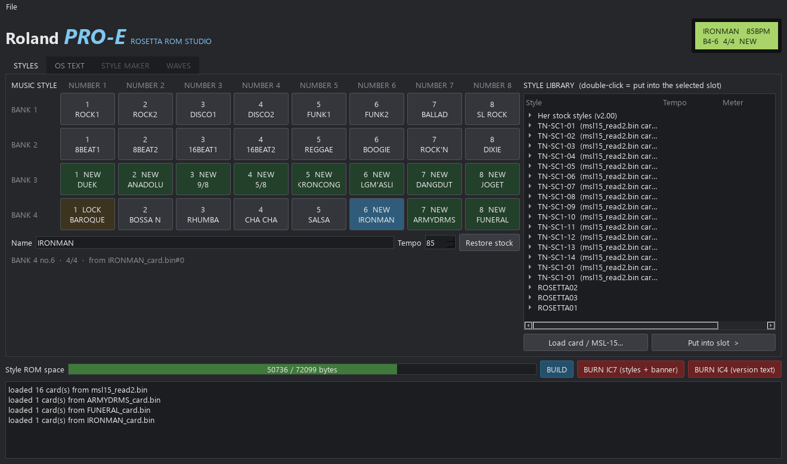

# Roland PRO-E mods: Rosetta OS custom firmware with Juno mode, new effects and styles from MIDI

**Rosetta E-Style Studio + PRO-E mods** (WIP) · for the Roland **PRO-E** (Pro-E / Pro E / ProE) Intelligent Arranger and the
E-series arrangers · [project page](https://yuyoi.github.io/Rosetta-E-Style-studio-and-Pro-E-mods/)

<!-- art: docs/mascot/ (JSW is drawing the ad) -->

Pull the **Roland E-series arrangers** into this century: a **Juno mode** for the PRO-E's LA synth engine, a **Juno
chorus, delay, lo-fi and drive** on its own reverb chip, new **music styles from any MIDI file**, the **hidden styles**
nobody could select, and a custom OS for the **PRO-E Intelligent Arranger** (1989, made in Italy, with an MT-32 /
CM-32L voice board inside). Build it in one app and burn it straight to a T48 programmer.

> **Made by JunkSmithWizard (JSW) together with Claude (Anthropic's AI).** Claude wrote the code and did the
> reverse engineering (both CPUs, the style and card formats, the wave/loop tables). JSW did all the hardware on
> their own first synth: socketed six chips, dumped every ROM, repaired the traces, did the pin-31 mod, burned and tested every build on
> the real PRO-E. JSW also brought the MSL-15 dump and made the calls that found things: *"is 14 the last button?"*
> (two hidden style banks) and *"the DAC demux is the same, the outs might just be disabled"* (extra outputs).

*Styled after the PRO-E's front panel: the 4 × 8 MUSIC STYLE buttons, green backlit LCD, style library on the right.*

🎧 **Listen:** [▶️ play it on the project page](https://yuyoi.github.io/Rosetta-E-Style-studio-and-Pro-E-mods/#listen) · [MP3](docs/audio/roland-pro-e-rosetta-os-juno-chorus-resonant-filter-jam.mp3): JSW jamming the PRO-E, Juno chorus + resonant DSP filter
(2 min 35 s, recorded straight from her outputs; the filter, bender and PWM firmware are all in this repo now, OS v0.11).

## What works (tested on a real PRO-E)

| | |
|---|---|
| **Your MIDI → a style** | Iron Man and Funeralopolis play from the panel buttons, following your left-hand chords, with the songs' own intros, fills and endings |
| **Hidden MSL-15 banks** | 8 styles that were in the MSL-15 ROM but had no button: KRONCONG, LANGGAM ASLI, DANGDUT, JOGET (Asia) and DÜYEK, ANADOLU, 9/8, 5/8 (Turkey). Now on BANK 3 |
| **Any TN-SC1 card style → an internal slot** | pick from all 16 MSL-15 cards (~68 styles), byte-checked against the original card data |
| **OS text** | your own boot banner and version screen |
| **SYNTH EDIT** | press CURSOR: tone editing on her own panel, 19 pages (Juno, filter, envelope, pitch env, LFO, voice, waves, live filter, effects…), changes heard as you turn the dial. The tone is read back from the voice board first. [re/SYNTH_EDIT.md](re/SYNTH_EDIT.md). Needs the pin-31 mod |
| **JUNO mode** | MAKE JUNO turns any tone into saw + pulse + sub oscillator + detuned saw through one filter and envelope, then SAW / PULSE / SUB levels, pulse width, DETUNE and RANGE like a Juno panel. **PWM** knob (0-10): real pulse-width modulation, an LFO in IC28 rewrites the LA chip's pulse width, LFO RATE sets the speed. `tools/juno_patch.py strings` loads a Juno PWM string patch |
| **Live filter** | cutoff and resonance changes reach notes you're holding (IC28 build), so filter sweeps work like a real knob |
| **Resonant filter** | a state-variable filter running *on the Boss reverb chip* (IC13 mode 0): LP, LP RES, BP, BP RES, 110 Hz-7 kHz in 16 steps. Filters everything sent to the effect, PCM samples too. LIVE FILTER page: FX CUTOFF / FX RESO |
| **BENDER mode** | PITCH / CUTOFF / RESO: the bender sweeps the resonant filter instead of the pitch. Bandpass + bender = a wah |
| **Wet-only mod** | cut **R27 + R31** on the CK-34 and parts with the effect on are heard *only* through the effect, so an effect sounds like an effect. REVERB OFF plays every part dry (IC28 v7 reroutes them). [re/REVERB_CHIP.md](re/REVERB_CHIP.md#wet-only-mod-r27--r31) |
| **ROSETTA FX** | new programs for her Boss reverb chip (IC13): a moving **Juno chorus** (the full Juno-60 sweep, 128 positions, no clicks), **delay** 40-495 ms with feedback, **lo-fi** bit crush, **drive**, **flanger**, **Juno chorus + reverb** (D-50 style), the resonant filter, plus Roland's hall. Per-part routing keeps the drums dry. [re/REVERB_CHIP.md](re/REVERB_CHIP.md) |
| **MIDI remote** | `tools/proe_link.py`: press her keys, turn the dial and read her screen from a PC, and record her through an audio interface. Every effect above was measured on her this way |
| **Pin-31 mod** | one wire through a sacrificial socket: the CPU switches IC7's two halves, so the full 512 KB of a W27C040 is usable. [docs/PIN31_MOD.md](docs/PIN31_MOD.md) |
| **Build + burn** | W27C040 (IC7), W27C512 (IC4, IC28, IC13) images: ID check, write, verify, readback. Drop-in, no board mods (except SYNTH EDIT) |

Every build checks itself before it writes anything: every kept style must decode to exactly its stock events,
every imported style must match its source pattern by pattern, and all IC7 bank checksums must add up.
One slot is locked: **BAROQUE**, the author's favourite. The build refuses to change a single byte of it.

## The E-series angle

The TN-SC1 style card is shared by the **E-5, E-20, E-30, E-35, E-70, PRO-E, RA-50, RA-90, CA-30, KR-500 and KR-3000**.
The Style Maker writes its output as a **TN-SC1 card image** (32 KB, Roland's own header and layout), so a song style should
work in any of them from the card slot once it's on a card. That needs a card adapter, which is next on the roadmap.
The internal-slot mods (IC7/IC4) are PRO-E specific. The E-20/E-10 share the PRO-E's CPU board, so they're the closest relatives.

> Only the PRO-E has been tested. Reports from other E-series owners are very welcome.

## Quick start (from source, Windows)

1. Python 3.10+ and `pip install -r romstudio/requirements.txt`.
2. **Dump your own chips** into `dumps/` (see [dumps/README.md](dumps/README.md)). No Roland ROM data is in this repo.
   The app needs IC7 (style ROM) and IC4 (OS EPROM) of a PRO-E v2.00. An MSL-15 or any TN-SC1 card dump goes in `dumps_ext/`.
3. `romstudio/run_romstudio.bat`.
4. **STYLES:** click a slot, double-click a style in the library. Rename it, set the tempo, or Restore stock.
   **OS TEXT:** banner and version screen. **BUILD**, then **BURN IC7 / IC4** (minipro + T48: put `minipro.exe` on PATH,
   in `Documents/tools/minipro_win/`, or set `PROE_MINIPRO`).
5. Put the burned chip in her socket, notch the same way. Keep your original chips: putting them back = stock.

### Make a style from MIDI

`romstudio/midi2style.py` turns a MIDI file into a style card. Right now you give it a small section map per song
(which bars are INTRO, BASIC, VARIATION, the two FILLs and ENDING; which channels are drums, bass and accompaniment;
the song's root). `romstudio/bar_map.py song.mid 2,1,10` prints a fingerprint per bar, so the repeating loops are easy to spot.
Your MIDI is kept as-is: it's quantized to the PRO-E's 24 PPQN (16ths, 8th triplets and 32nds are exact) and the converter
lists every note it had to move or shift an octave. Odd meters work: 6/8, 9/8, 12/8.

**Hold the song's root** in the chord zone and the whole progression plays as recorded. Other roots transpose it
(−4…+7 semitones, it never jumps register). Major, minor and 7th all play the song. Sus4, maj7, m7, dim and aug
recolour it: the arranger bends single notes to fit the chord.

## Hardware notes

| Socket | Original | Drop-in | Notes |
|---|---|---|---|
| IC4 (CPU board) | 27C128, OS kernel v2.00 | W27C512, image ×4 | socketed from the factory |
| IC7 (CPU board) | R15179983 LH53234L, 2 Mbit mask | W27C040, image ×2 | soldered; socket it. J1 stays on 2M. Pin 31 (A18) is tied high: [pin-31 mod](docs/PIN31_MOD.md) for both halves |
| IC37 / IC38 (CK-34) | wave ROMs R15449121 / R15179945 | W27C040 | = the CM-32L 1 MB PCM set |
| IC28 (CK-34) | R15179974, 8098 control ROM | needs an adapter | 28-pin, A16 on pin 22, /OE on pin 20 (D-110 LH5310 style) |
| IC13 (CK-34) | R15179917 BOSS reverb ROM | W27C512, image ×2 | 27C256-compatible pinout |

- Two CPUs: a **68HC11** (Italian arranger OS: panel, LCD, styles, MIDI) and an **Intel P8098** on the CK-34 voice board
  (Japanese, CM-32L hardware: LA32, BOSS reverb, firmware "CK-34 v2.06 89-02-28 ** Roland MT-32 **").
- The two talk **plain MIDI + MT-32 SysEx** at 31,250 baud. The CK-34 accepts standard MT-32 tone editing.
- Both brains carry credits: the Italian OS has the dev team **DEMETRIO LUIGI PAOLO PIERO ROBY**, and the CK-34 says *by S.Ishida*.
- Tools: `re/hc11asm.py` (68HC11 assembler, rebuilds the whole stock OS byte for byte) and `re/hc11sim.py` (simulator for testing patches before a burn).
  For the voice board: `ref_tools/mcs96_asm.py` / `mcs96_sim.py` / `mcs96_dis.py` (8096 assembler, simulator, disassembler)
  and `re/boss_reverb.py` (the Boss reverb chip, corrected against measurements on her).
- Full notes: [docs/HARDWARE_NOTES.md](docs/HARDWARE_NOTES.md), [docs/PIN31_MOD.md](docs/PIN31_MOD.md), [re/FIRMWARE_NOTES.md](re/FIRMWARE_NOTES.md),
  [re/WAVE_FORMAT.md](re/WAVE_FORMAT.md), [re/MULTI_OUTS.md](re/MULTI_OUTS.md), and the deep dives in [re/fw_map/](re/fw_map/README.md)
  (written by an analysis run that was stopped before its checkers finished: treat them as unverified).

## Status: work in progress 🚧

Planned, roughly in order ([ROADMAP.md](ROADMAP.md)):
- **Style Maker in the app:** drop a MIDI file, it finds the most-repeated loop (BASIC), the second one (VARIATION), the fills,
  intro and ending by itself, and you just check its picks.
- **TN-SC1 card adapter:** burn song styles onto a card for any E-series.
- **LFO block in IC28:** PWM is done. Next: LFO → filter, delayed vibrato, and the mod wheel as a second filter axis.
- **D-50 flavour:** the PRO-E has the D-50's LA chip. D-50 style LFOs, chorus + reverb and the famous D-50 patches as presets.
- **SYNTH EDIT save slots** on the WRITE key.
- **Rosetta Wave:** custom samples in IC37/IC38 plus the wave/loop table in IC28 (long-sample bank built, being tested).
- **Extra outputs:** after the wet-only mod the SYN1 dry signal is free: tap IC18 pin 1 / IC2 pin 7 (through a cap, then a small TL072 buffer board) for outs 3-4. Being tested.

## Legal

This repo contains no Roland ROM data, no dumps, no card images and no song MIDI files: only code, notes, and SHA-1 hashes
so you can check your own dumps. Roland, PRO-E, MT-32, CM-32L and MSL-15 are names of Roland Corporation, used here only
to say what this works with. The MIDI-to-style converter only converts files you supply.

MIT licence, except `re/boss_reverb.py`: a port of Sergey V. Mikayev's MT-32 reverb interpreter, so it stays LGPL-2.1+.
Ideas, bug reports and test results from other E-series owners are very welcome: open an issue or come to the Discord.
