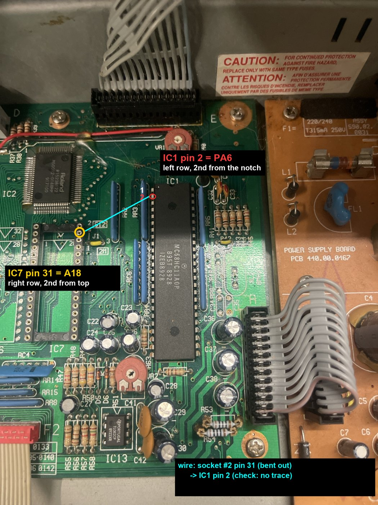
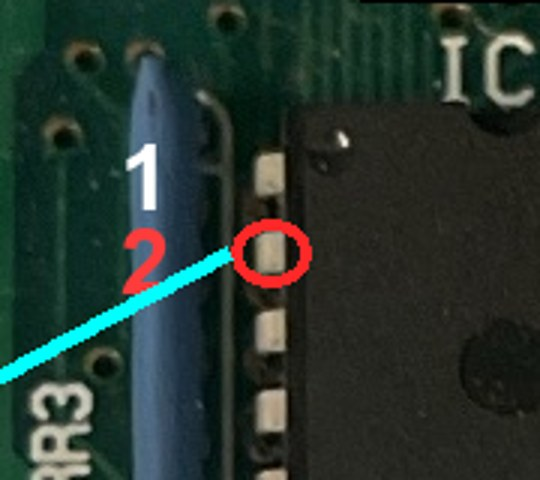

# The pin-31 mod: the full 512 KB of IC7, switched by the CPU

**Why:** IC7 was a 2 Mbit mask ROM. On a W27C040 (4 Mbit) drop-in, pin 31 is A18, but the PRO-E board ties pin 31
to +5 V (it's the program-enable pin of a 2 Mbit EPROM). So she only ever reads the **upper** 256 KB of the chip.

**The mod:** pin 31 gets the 68HC11's spare output **PA6** (IC1 pin 2) instead of the board's +5 V. Her own firmware
keeps PA6 low, so she boots the **lower** half as usual. Rosetta code switches PA6 high for a few microseconds to run
from the upper half (that's where SYNTH EDIT lives), then back.

| Point | Where |
|---|---|
| **IC1 pin 2 = PA6** | MC68HC11A0P, left row, 2nd pin from the notch. The schematic shows it with only the RR3 10 k pull-up on it (pin 1 = PA7 = GTRIG: don't use that one) |
| **IC7 pin 31 = A18** | the IC7 socket, right row, 2nd from the top (pin 32 = Vcc is the top right) |

## How (no legs touched on any original chip)

1. Stack a **sacrificial machined socket** between the board's IC7 socket and the chip (or the ZIF).
2. **Cut its pin-31 leg off** and mask the stub, so nothing on the board reaches pin 31 any more.
3. Wire that socket's pin-31 contact to **IC1 pin 2**. Keep it short and away from the crystal.

## Test it (before any SYNTH build)

- With the stock OS (or any v0.3 build) she must boot normally: PA6 is low, so pin 31 reads **0 V**.
- `re/build_pa6test.py` builds an IC4 that flips PA6 six times during the boot banner. With an IC7 whose halves have
  different banners (e.g. "LOWER HALF" / "UPPER HALF") the banner must flip **LOWER → UPPER → LOWER …** and then boot.
  If it stays on LOWER, the wire isn't reaching pin 31.

## Gotchas we hit

- **5 V on pin 2 / "UPPER HALF" after the mod** = the wire or the cut leg still touches something (in our case a bad
  contact). A clean pin 2 reads 0 V: her code writes PA6 = 0 at reset (`$C05B`) and on every key scan (`$4C8F`).
- **Blank screen** right after fitting the adapter = the stacked socket wasn't seated on its other pins.
- Without the mod, an image only works if both halves are identical (she runs the upper one).
